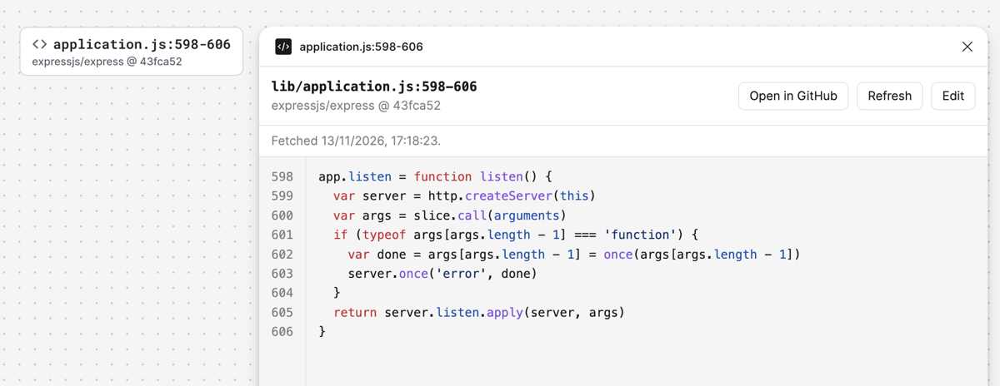
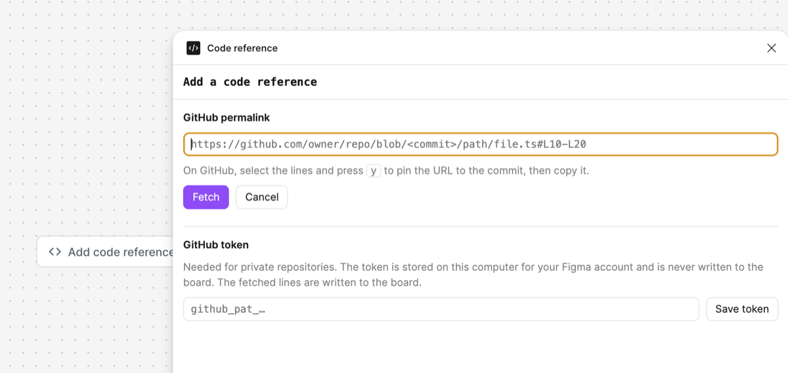

# figjam-code-ref

A FigJam widget that links a diagram element to the code behind it. You paste a GitHub permalink into the widget. It fetches those lines, and clicking the widget shows them in an overlay next to it.



## How it works

- Each widget holds one permalink. On the canvas it shows the file name and line range, the repository, and the first 7 characters of the commit.
- Clicking the widget opens an overlay with the lines, syntax-highlighted and numbered as in the file. The overlay has buttons to open the permalink on GitHub, fetch it again, and change it.
- The widget fetches the file from the [GitHub contents API](https://docs.github.com/en/rest/repos/contents) and stores the selected lines in the widget's synced state. Everyone who opens the board sees the stored lines without a GitHub token.

## Install

You need Node.js 22.18 or later and the Figma desktop app.

```sh
git clone https://github.com/0xRezaa/figjam-code-ref.git
cd figjam-code-ref
npm ci
npm run build
```

In the Figma desktop app, open a FigJam board. In the main menu, choose **Widgets → Development → Import widget from manifest…** and select `manifest.json`.

## Use

1. Insert the widget from **Widgets → Development → Code Reference**.
2. On GitHub, open the file and select the lines: click the first line number, then shift-click the last. Press `y` to replace the branch name in the URL with the commit SHA, then copy the URL.
3. Click the widget, paste the URL, and choose **Fetch**.

To add another reference, copy and paste the widget. Each copy holds its own permalink.



## Private repositories

The widget needs a GitHub token to read a private repository. Create a [fine-grained personal access token](https://github.com/settings/personal-access-tokens/new) with these settings:

- **Repository access:** only the repositories you want to reference.
- **Permissions:** Contents, read-only.

Paste the token into the overlay and choose **Save token**. The widget stores it with `figma.clientStorage`, which keeps it on your computer for your Figma account. The token is not written to the board, and the widget sends it only to `api.github.com`.

Without a token, the widget reads public repositories within GitHub's limit of 60 requests an hour per IP address.

## Limits

- Only people with edit access to a board can click widgets. People with view access see the label only.
- The fetched lines are stored in the board. Anyone who can open the board can read them, whether or not they can read the repository.
- A widget shows at most 500 lines.
- It reads from github.com only. GitHub Enterprise Server is not supported.
- A URL that names a branch instead of a commit works. The widget marks it "not pinned", and **Refresh** fetches the branch's latest version. Branch names that contain a slash are not supported.

## Development

```sh
npm run check   # type-check, test and build
```

| Path | Contents |
| --- | --- |
| `shared/permalink.ts` | Permalink parsing, GitHub URLs, line slicing |
| `widget-src/code.tsx` | The widget and the GitHub request |
| `ui-src/` | The overlay |
| `scripts/build.mjs` | Bundles the widget and inlines the overlay into `dist/index.html` |

`manifest.json` holds the widget's Figma Community ID, `1703111892180213963`. Keep it when you publish an update, so Figma treats the upload as a new version of the same widget.

## License

[MIT](LICENSE)
